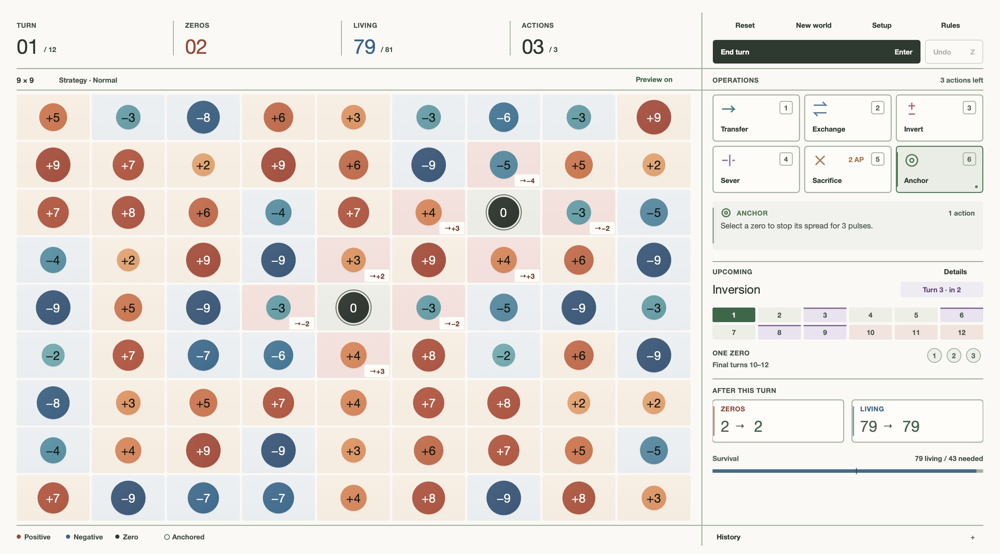

# Zero Is Infectious

A strategy game about containing an infection (represented by the number zero) in a numerical world. Built in C++/JUCE.



*9×9 Strategy world, with next-pulse previews enabled.*

## Rules at a glance

- **Win:** preserve exactly one zero in the same cell for the final three turns, while keeping the minimum living population alive. “Living” means nonzero cells; zeros and removed cells do not count.
- **Take a turn:** spend your available action points on the six operations, then choose **End turn**. Most operations cost one action; Sacrifice costs two. You can end a turn with actions unspent.
- **Contain infection:** unanchored zeros reduce neighbouring values toward zero simultaneously. Three-zero lines and 2×2 colonies spread farther; negative values resist overlapping attacks. Anchor stops a zero spreading for three pulses, or two on Hard.
- **Plan ahead:** board badges preview the next pulse. **After this turn** predicts the complete outcome, including geometry changes and survival checks. Scheduled weather changes values, tools can become corrupted, and larger boards can gain satellite zeros.
- **Survive:** you lose if living cells fall below the minimum, the zero colony reaches its limit, or final containment fails. Optional geometry modes expand or contract the world; with zero-driven geometry, the final board cannot be more than one size step smaller than its starting size.

## Download

[Download the macOS app — Apple Silicon](https://github.com/maetyu-d/zero_is_infectious/raw/refs/heads/main/dist/Zero-Is-Infectious-1.3-macOS-arm64.zip). Extract the ZIP and open **Zero Is Infectious.app**.

The included app is version 1.3 and runs natively on Apple Silicon Macs. The source can be built for other platforms supported by JUCE; those builds have not been verified here.

## Build

Requires CMake 3.22 or later and a C++17 compiler. On macOS, install Apple's command-line developer tools. The default configuration downloads JUCE 8.0.12, pinned to an upstream commit, during configuration.

```sh
cmake -S . -B build -DCMAKE_BUILD_TYPE=Release
cmake --build build --config Release -j 6
ctest --test-dir build -C Release --output-on-failure
```

The macOS app is produced at `build/ZeroIsInfectious_artefacts/Release/Zero Is Infectious.app`.

To use an existing JUCE source checkout instead of downloading it:

```sh
cmake -S . -B build -DCMAKE_BUILD_TYPE=Release -DJUCE_DIR=/absolute/path/to/JUCE
```

The engine can be tested without JUCE or network access:

```sh
cmake -S . -B build-tests -DZERO_BUILD_APP=OFF -DCMAKE_BUILD_TYPE=Release
cmake --build build-tests
ctest --test-dir build-tests --output-on-failure
```

## Controls

Setup offers 5×5, 7×7, 9×9, 11×11, or 13×13 worlds, three difficulties, and optional geometry modes.

| Key | Operation | Behaviour |
| --- | --- | --- |
| 1 | Transfer | Move magnitude within two cells; a zero recipient can be healed. |
| 2 | Exchange | Swap neighbouring cells. |
| 3 | Invert | Reverse the sign of a nonzero cell. |
| 4 | Sever | Block an adjacent edge temporarily. |
| 5 | Sacrifice | Remove a cell permanently; costs two actions. |
| 6 | Anchor | Temporarily stop a zero spreading. |

Transfer, Exchange, and Sever use two cell selections. Enter ends the turn; Z undoes the last operation; Escape clears a selection; ? opens the rules. Arrow keys move the highlighted cell and Space operates on it.

## Interface

The app fills the display work area. Board cells adapt to window proportions while their number discs stay circular. Native controls provide keyboard focus and hover feedback; the sidebar scrolls when space is limited. Version 1.3 increases small-text size and weight, strengthens contrast and rules, and improves dense-board preview readability. The game is silent.

## Source and verification

- `Main.cpp`: native JUCE interface and application entry point.
- `Engine.h`: seeded world generation, operations, infection, weather, geometry, and win/loss rules.
- `Tests.cpp`: deterministic engine checks.
- [Verification](Verification.md): build, reference comparison, and visual checks.

JUCE is an external dependency. Its upstream license notice is included in [JUCE-LICENSE.md](JUCE-LICENSE.md).
